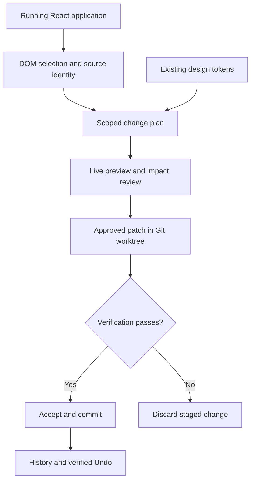

# PointBuild

**Status: In development — local prototype. This is not a finished or generally released product.**

**A visual review and editing prototype that connects an element in a running web application to a scoped, previewable, verifiable source-code change.**

I am developing PointBuild to reduce the gap between noticing a UI problem and applying the exact intended correction. The user should be able to select an area, adjust the result visually, understand the impact, apply it, and undo it without needing to understand the internal Git and validation pipeline.

| At a glance | |
| --- | --- |
| My role | Project owner and developer, covering product workflow, source instrumentation, editing controls, and verification |
| Stage | In development: local React/Vite prototype; broader product completion and usability validation are ongoing |
| Engineering focus | DOM-to-source identity, bounded changes, design-token reuse, isolated staging, and reversible Git history |
| This repository | Public technical case study; the full implementation remains private |

[Problem and motivation](#problem-and-motivation) · [Architecture](#architecture) · [Core engineering](#core-engineering) · [Technology stack](#technology-stack) · [Verification and limitations](#verification-and-limitations)

**Inspect runnable code:** [source-derived target-identity example and tests](examples/). This small example demonstrates one implemented mechanism; it is not the complete visual editor.

## Problem and motivation

A request such as “reduce the spacing in this list” contains information that a screenshot or text prompt can lose:

- Which list and which repeated instance does the user mean?
- Should the edit affect one element, the shared component, or the whole page?
- Which existing spacing value fits the project's design system?
- How can the reviewer inspect the result before a source change is accepted?

This matters for developers refining agent-generated interfaces and for designers who can judge the visual result but do not work with selectors, component files, or Git.

Visual targeting is an established product category: [Cursor's Design Mode documentation](https://prod.cursor.com/docs/agent/design-mode) describes supplying element and layout context to coding agents. PointBuild's product hypothesis is that **explicit scope, preview, impact review, verification, and reversal** deserve a coherent workflow around that interaction. This is a positioning hypothesis, not a claim of measured superiority or validated willingness to pay.

I chose the problem because visual intent has to survive several translations: from the user's selection, to the correct source location, to an acceptable patch, and finally to the result the user approved.

## Intended users and current workflow

| User | Need |
| --- | --- |
| Developer or technical founder | Refine an existing application without repeatedly explaining element locations |
| Designer or product reviewer | Adjust and compare a visible result using familiar controls |
| Team reviewing agent-generated changes | Keep edits bounded and inspect their effects before acceptance |

The current designer-oriented flow is:

1. Select an element and choose a source-mapped scope such as an item or its list.
2. Describe the desired result or choose a supported project style value.
3. Preview the proposed result and compare before/after states.
4. Review other affected areas when a shared style or component is involved.
5. Apply the reviewed change; use Undo when necessary.

The internal process retains an approved change plan, isolated staging, desktop/mobile QA evidence, a local Git commit, and durable history. Those mechanics belong behind the normal interaction rather than becoming concepts every designer must learn.

## Architecture

The diagram shows how a visual choice becomes a controlled source edit, including its rejection and reversal paths.

## Core engineering

### 1. Connect rendered elements to source identity

**Decision:** instrument development-time JSX through a Vite/Babel plugin and attach source metadata to rendered elements.

A selector alone can become ambiguous when lists repeat, routes change, or components rerender. The target contract includes source/component context, route, visible text, bounding box, viewport, and an identity strategy. Instance keys, DOM IDs, test IDs, and source occurrence provide different identity options.

**Why it matters:** the editing system needs a reason to believe it is changing the element the reviewer actually selected.

**Boundary:** development-time source instrumentation is an intentional compatibility constraint. Arbitrary minified production pages are outside the current supported path.

### 2. Reuse the project's visual vocabulary

**Decision:** discover existing styles and design tokens, and prefer supported deterministic transformations for simple changes.

The implementation includes CSS custom-property discovery, token usage and impact analysis, and token-backed preview. A proposed replacement must resolve to an existing, unambiguous token rather than silently inventing a new styling convention.

**Why it matters:** users can choose a visible result while the system preserves the relationship between that result and the project's existing styles.

**Trade-off:** supported token edits are more constrained than arbitrary CSS generation. That smaller scope makes the change easier to explain and verify.

### 3. Bind approval to a specific change

**Decision:** represent the edit as a bounded change plan with source revision, target, permitted changes, and approval checks.

The local token execution path rebuilds and compares the plan before staging. Patch fingerprints bind subsequent review to the staged result. A changed source revision or mismatched approval invalidates the operation instead of silently applying an old decision to new code.

**Why it matters:** approving a preview should not authorize a different patch after the underlying application has changed.

### 4. Stage changes outside the active source tree

**Decision:** use an isolated Git worktree for patch preparation, diff checks, validation hooks, and acceptance.

The patch transaction has explicit active, validated, accepted, and aborted states. It captures the forward and reverse patch and checks the source revision before acceptance.

**Trade-off:** Git adds lifecycle and clean-working-tree requirements. In return, staging can be discarded without treating the user's active source directory as a scratch buffer.

### 5. Treat verification and Undo as part of editing

**Decision:** require desktop/mobile QA evidence for the implemented token acceptance path and retain history for controlled reversal.

The code checks that verification evidence belongs to the staged execution and records patch fingerprints and accepted changes. Undo works through tracked Git changes rather than an untracked visual reset.

**Why it matters:** an edit is complete when the reviewed result has been accepted and can be traced or reversed, not merely when a file has been modified.

## Technology stack

| Layer | Technology | Responsibility |
| --- | --- | --- |
| Interface | React, TypeScript, HTML/CSS | Selection, scope controls, review state, and preview interactions |
| Development integration | Vite, Babel parser/traversal/generator | JSX instrumentation and source metadata |
| Local execution | Node.js, Git, temporary worktrees | Scoped staging, validation, commits, and reversal |
| Styling analysis | CSS custom properties, design-token analysis, Tailwind-oriented utilities | Reuse and impact analysis of existing project styles |
| Unit/component logic checks | Vitest | Identity, tokens, plans, scope locks, patch transactions, and history |
| Browser verification | Playwright | Selection, preview, apply, persistence, visual evidence, and Undo flows |
| Automation | GitHub Actions | Configured unit, browser, build, and compatibility checks |

## My contribution

- Translating the product requirement into a designer-oriented selection-to-result workflow.
- Developing source instrumentation, stable target context, and scope selection.
- Building design-token discovery, supported edit planning, and live previews.
- Implementing staged patch transactions, approval checks, verification bindings, and Git-based history/Undo.
- Defining compatibility boundaries and automated unit/browser checks.

## Verification and limitations

The private repository contains unit tests for target identity, deterministic transforms, scope locking, token planning, staged patches, history, and Undo. Browser specifications cover source mapping, live preview, designer apply, review persistence, desktop/mobile evidence, and local undo.

The configured verification commands include `npm test`, `npm run test:e2e`, and `npm run build` in the private implementation. They were not rerun as part of publishing this documentation; this public case study does not contain the runnable application.

Current boundaries and next priorities:

- The implemented path centers on local React/Vite development and supported deterministic text/style edits.
- Source mappings and identity must remain valid across rerenders and repeated elements; ambiguous or unsupported cases should be rejected.
- AI-agent adapters and PR handoff modules exist, but broad agent/provider compatibility is not claimed as a completed integration.
- Wider framework support and first-time designer usability require further compatibility and user testing.
- No measured productivity improvement, customer adoption, or market-size claim is made here.

## Reviewing the project

The central technical question is: **how can a visual instruction become exactly the source change the user reviewed, with enough evidence to accept or undo it?**

This showcase explains that design without distributing the private implementation. A technical walkthrough and a scoped source-code review can be arranged on request.

[Sunmin Lee — GitHub profile](https://github.com/sunminlee-ucd) · [LinkedIn](https://www.linkedin.com/in/sunmin-dev/)

*Implementation and supporting documentation reviewed on 18 October 2026.*
